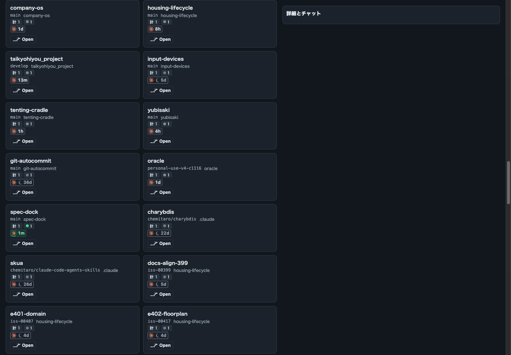
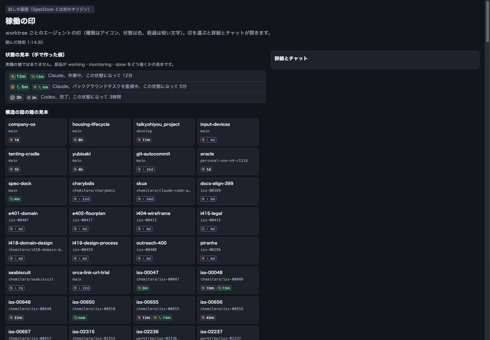
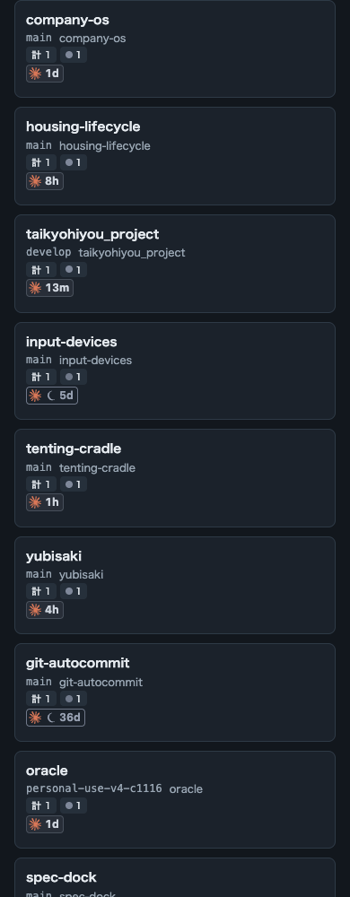
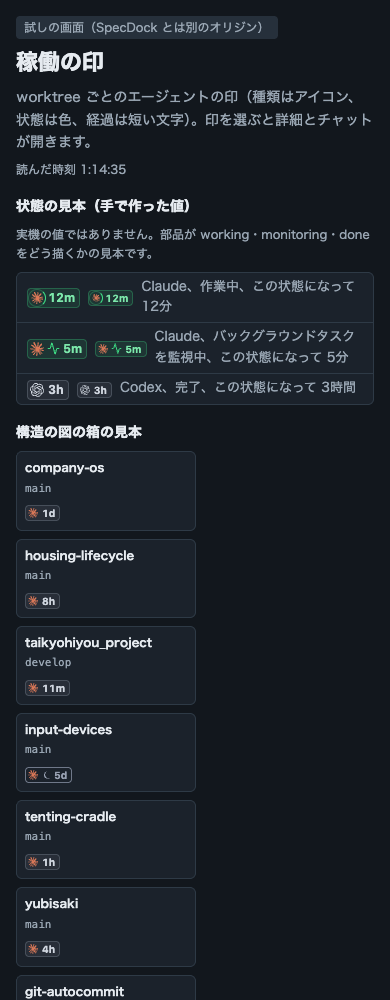

# Result Summary

詳細: [Report Guide](../../../docs/authoring/report.md)

## Outcome

「Orca で開く」が画面を切り替えなかった原因を Orca 1.4.261 のソースと実機で特定し、orca-web の開く口を、押した端末の Orca で worktree を先に表示してからタブを選ぶ形に直した。

### 原因（Orca 1.4.261、ソース v1.4.261 = 92d4266c）

- `session.tabs.activate` は、選んだタブが端末でない（構造化 Chat などの agent-session）とき、窓へ `ui:focusEditorTab` を `userInitiated` なしで送る（`src/main/runtime/session-lifecycle/projection/perform-mobile-session-pty-records-refresh.ts` の `this.notifier?.focusEditorTab?.(tab.id, worktreeId)`）。
- 窓の側（`src/renderer/src/hooks/ipc-events/terminal-ui-routing-ipc-bridge.ts` の `onFocusEditorTab`）は、`!userInitiated && tab.contentType === 'agent-session' && store.activeWorktreeId !== worktreeId` なら何もしない。RPC の `intent: "user"` は窓まで渡らない。
- 端末のタブは `ui:focusTerminal` → `revealWorkspaceSurface` で worktree ごと切り替わる。`worktree.activate`（host）は `ui:activateWorktree` → `activateAndRevealWorktree` で切り替わる。
- 窓の今の worktree を読む RPC はない（`ui.get` の `lastActiveWorktreeId` は null）。
- 統括が観測した「`orca worktree activate` でも切り替わらない」は再現しなかった（原因は未確定。その時の対象か画面の条件の違いと見る）。

### 直したこと（PR の差分 27b01fe..HEAD）

- 開く口（`src/orca/open.ts`）：いつも `worktree.activate` を先に送り、次にタブを選ぶ（`terminal switch` か `session.tabs.activate`）。1 の失敗・結果不明では 2 を送らない。2 の失敗は `worktreeShown: true`。`route` は最後に送った書き込みの経路。
- 押した端末（`src/orca/open-device.ts`）：要求の TCP の元のアドレスが loopback かホストの口なら host、Orca のランタイムの websocket に確立した接続（`/usr/sbin/lsof`）があれば client（`navigation: "clients"`）、ほかは `device_not_connected`（409）、読めなければ `device_unknown`（503）。
- 門（`open-gates.ts`）：activate は navigation が `host` か `clients` のときだけ。
- 前面：ホストは `/usr/bin/open -b com.stablyai.orca`（`raise.ts`、結果の `raised`）。クライアントはボタンが `orca://` へ移る（`open-control.js` の `raiseClient`）。埋め込みの iframe の sandbox に `allow-top-navigation-to-custom-protocols` を足した（`open-button.js`）。
- 結果とボタン：成功に `device`・`screen: "unverified"`。ボタンは「Orca に切り替えを送りました」（クライアントは「この端末の Orca に…」）。
- README.md・AGENTS.md：端末の決め方、`clients` が接続中のすべての端末を動かす制約、見分けられない接続（relay、LAN、IPv6）、sandbox、`screen: "unverified"`。

## Verification

### ホストの実機（タスク担当、2026-11-18）

画面の写しは、会話の中身が写り込み、手元にぼかす道具（PIL など）がないため載せない。代わりに Orca の主窓のアクセシビリティの木（`orca computer get-app-state --query タブ`）のタブの帯の行を記す（ほかのプロジェクトの題名は伏せる）。

| 時刻 | 操作 | 結果 | タブの帯（主窓） |
|---|---|---|---|
| 00:46:15 | 前 | — | `<別のプロジェクト>`、`<別のプロジェクトのチャット>` |
| 00:46:28 | `orca worktree activate`（host）で作業の済んだ `orca-web-iss-00041` へ（直す前の確かめ） | `activated: true` | `Terminal 1`（切り替わった。タブのない worktree に Orca が端末を1つ作った） |
| 00:46 頃 | 元へ戻すつもりで `session.tabs.activate`（host、intent user）を別の worktree の agent-session のタブへ | ok | `orca-web-iss-00041`（**切り替わらない**。不具合の再現） |
| 00:47 頃 | `worktree.activate` で元の worktree へ、次に `session.tabs.activate` | ok | 元の2つのタブ（戻った） |
| 01:12:29 | 直した後：前 | — | `<別のプロジェクト>`、`<別のプロジェクトのチャット>` |
| 01:12:46 | 一時の orca-web（127.0.0.1:8792、新しいコード）の `POST /api/open` で、この Issue の worktree（agent-session のタブ、不具合と同じ形）へ | `{ok: true, route: "tab-activate", reason: "last-tab", device: "host", screen: "unverified", raised: true}` | `orca-web iss-00047 …`、`iss-00047 S-02 …`（**切り替わった**、Orca が前面に） |
| 01:13 頃 | 元の worktree とタブへ戻す | ok | 元の2つのタブ（戻った） |

### Chrome（headless、Chrome の CDP、ホスト）

sandbox の iframe の中のボタンを押し（`Input.dispatchMouseEvent`、利用者の操作として扱われる）、`location.href = '<未登録の scheme>://x'` を試した。

- `allow-scripts allow-same-origin allow-top-navigation-to-custom-protocols`：sandbox を通り、`Failed to launch '…' because the scheme does not have a registered handler`（登録された `orca://` なら OS に渡る）。
- `allow-scripts allow-same-origin`（直す前）：`Navigation to external protocol blocked by sandbox, because it doesn't contain any of: 'allow-top-navigation-to-custom-protocols', 'allow-top-navigation-by-user-activation', 'allow-top-navigation', or 'allow-popups'`。

### 本人の確かめ待ち

- R-02（クライアントの PC で押すと、クライアントの Orca が切り替わり、ホストは動かない）と、Safari での `orca://`：Safari は自動で確かめる手段がない（safaridriver を有効にするには本人の設定を変える）。手順を統括に送り（2026-11-18）、本人の結果を待っている。試しの orca-web（8792）と試しの画面（47900）はそのために動かしたままにしている。

### 試しの画面（`npm run trial`、headless Chrome で撮影）

- Mac の幅（1440px）：（節ごとの Open のボタン。見た目は変えていない）、
- 390px：、（390px 以下では開くボタンを出さない今の決まりのまま）

### テスト

`npm run lint` 0、`npm test` 752 合格（開始時 730）、`npm run build` 0。

## Orca に出す不具合の報告の下書き

> **`session.tabs.activate` with `navigation: "host"` does not switch the desktop window to another worktree when the target is an agent-session (structured chat) tab**
>
> Version: Orca 1.4.261 (macOS).
> Steps: with worktree A selected in the desktop window, call the runtime RPC `session.tabs.activate {worktree: "id:<B>", tabId: "agent-session:<id>", navigation: "host", intent: "user"}` (B ≠ A).
> Expected: the window shows worktree B with that chat tab selected (like clicking the sidebar, then the tab).
> Actual: the RPC returns ok with the snapshot, but the window stays on A. Terminal tabs work (they go through `focusTerminal` → `revealWorkspaceSurface`).
> Cause: `perform-mobile-session-pty-records-refresh.ts` calls `notifier.focusEditorTab(tab.id, worktreeId)` without `userInitiated`, and `terminal-ui-routing-ipc-bridge.ts` `onFocusEditorTab` returns early for an agent-session tab when `activeWorktreeId !== worktreeId` and `!userInitiated`. The RPC's `intent: "user"` is not forwarded.
> Suggestion: pass `{ userInitiated: !isAutomaticTabActivation(opts.intent) }` (or reveal the workspace surface) for explicit host activations.
> Workaround: call `worktree.activate` (`navigation: "host"`) first.

## Residual Risks / Follow-ups

- Orca の窓は `worktree.activate` を非同期に処理する（`fetchWorktrees` の後）。続けて送るタブの選択が先に届くと、agent-session のタブの選択は捨てられうる（worktree は表示され、窓が覚えているタブが出る）。
- `clients` は接続中のすべての端末（iPhone のアプリも）を動かす（統括が受け入れ）。
- relay、同じ Wi-Fi の LAN、tailnet の IPv6 で接続するクライアントは見分けられず `device_not_connected` になる。
- 切り替わったかは確かめられない（`screen: "unverified"`）。
- Safari の sandbox の iframe からの `orca://` は本人の確かめ待ち。

## レビュー記録

- spec-review（spec-reviewer、Claude Opus 5.5 / high）：round-1 fail（P1×1、P2×3、P3×1。応答は `.workbench/spec-review/iss-00047/review-response.md`）→ round-2 **pass**（P3×1：D-06 の README の項目。S-03 で README を書くときに、sandbox の主体を orca-web の open-button.js、LAN・IPv6 の制約として書く）。合格の sha256：requirement.cue 85e8444f…1152、design.cue 181d2aa6…e321、plan.cue 024dd63e…8a。

## 逸脱と判断

- S-01 の実装担当：Codex GPT-6.1 Sol / medium（ctx_90ef40473b08）は、sandbox の初期化で chat-scratch の writable root が symlink を含むとして拒まれ、何も変えずに止まった。統括の了承済みの手順どおり worker-stop し、Claude Opus 5.5 / medium（ctx_41e98a4ba9e0）に切り替えた。
- final-quality-gate（iss-00047-fqg1）：5a8bad4 で **pass**。レビュー attempt 01 fail（FQG-001：実機の記録の未完。記録を書いて応答）→ attempt 02 pass（P2 1：Safari 未確かめ）。2人目 ChatGPT GPT-6 / Extra High pass（P2 2：未送信の 2 の route、lsof の終了コード 1 と stderr）。テスト lint 0・test 752 合格・build 0。closure：`closure.md`。

## 統括の締め（2026-11-20）

- PR #51（合格のコミット 5a8bad4）は 2026-11-17 にマージ済み（47cbc20）。常駐の orca-web はその後の版で動いている。最終品質ゲートは closure.md のとおり合格。
- 本人の確かめ待ちの2点（R-02：クライアントの PC で押すとクライアントの Orca が切り替わりホストは動かない、R-04：Safari の sandbox の iframe からの `orca://`）は、この Issue の中では確かめていない。常駐の orca-web で本人がいつでも確かめられるので、Issue は完了とし、2点は orca-web のカタログの人のタスク（check）で追う。不具合が見つかれば、新しい Issue にする。
- 試しの orca-web（8792）と試しの画面（47900）は、すでに止まっている。
- closure.md の P2（ChatGPT の2件：送っていない段の route、lsof の終了コード 1 の扱い）は直していない（情報）。
